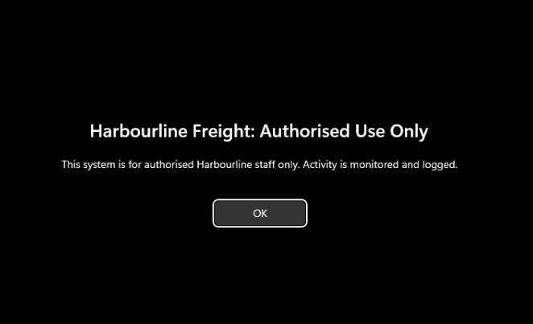

# Purple Team Journey

Learning both sides of security: how attacks work and how to catch them.

I'm a Bachelor of IT student at CQUniversity (Cyber Security major, Application
Development minor), based in Sydney and working toward a purple team role. This
repo is where I build an Active Directory lab, attack it, detect the attacks in
my own logs, and write up everything I learn and break along the way.

## Overview

The lab is a small Active Directory environment running on my laptop under KVM.
I turned the domain into a fake company, Harbourline Freight, with departments,
staff, groups, Group Policy and a service account, so there is something
realistic to attack and defend. Every build step, test and problem is written up
in [labs/ad-lab](labs/ad-lab).

## Lab architecture

```
 Arch Linux host  (Ryzen 7 7435HS, 16 GB RAM, KVM / libvirt / virt-manager)
        |
        |  libvirt network "lab"
        |  NAT, DHCP off, libvirt DNS off, 10.10.10.0/24, bridge virbr10
        |  (DHCP and DNS are off on purpose: in AD the DC must be the only DNS)
        |
   +----+-------------------+-------------------------+
   |                        |                         |
 DC01                     WIN11                      KALI
 Windows Server 2025      Windows 11 Pro             Kali 2026.2
 10.10.10.10              10.10.10.20                10.10.10.30
 AD DS + DNS              domain-joined client       attacker, not joined
 forest purple.internal   Sysmon + audit logging     recon and attack tools
```

- Domain: `purple.internal` (NetBIOS `PURPLE`), run as the fake company
  Harbourline Freight.
- The network is NAT only, so the VMs reach the internet but nothing outside can
  reach them.
- Full build notes, including the libvirt network XML and every `virt-install`
  command, are in [labs/ad-lab/README.md](labs/ad-lab/README.md).

## What's built so far

| Area | What | Write-up |
|---|---|---|
| Lab infrastructure | Three VMs on an isolated NAT network, host snapshots with Timeshift | [ad-lab/README.md](labs/ad-lab/README.md) |
| Domain as a company | OUs, 12 staff, security groups, three GPOs, a Kerberoastable `svc_sql` account | [domain-structure.md](labs/ad-lab/domain-structure.md) |
| Audit logging | One GPO, 10 audit subcategories, tested with real 4688/4771/4728 events | [audit-policy.md](labs/ad-lab/audit-policy.md) |
| Endpoint telemetry | Sysmon on WIN11 with the SwiftOnSecurity config, traced through events 1, 3 and 22 | [sysmon.md](labs/ad-lab/sysmon.md) |
| First purple loop | Kerberoasting: attack from Kali/WIN11, detect in 4769, harden | [kerberoasting.md](labs/ad-lab/kerberoasting.md) |
| Second purple loop | LLMNR/NBT-NS/mDNS poisoning: capture a hash, detect it, harden all three protocols | [llmnr.md](labs/ad-lab/llmnr.md) |
| Central SIEM | Wazuh all-in-one collecting Security + Sysmon from both Windows hosts, with custom detection rules | [wazuh.md](labs/ad-lab/wazuh.md) |



## Attack and detect methodology

Each exercise follows the same loop, which is the point of working purple:

1. **Make the box log things.** Turn on the audit policy and Sysmon first, so
   there is something to find later. See [audit-policy.md](labs/ad-lab/audit-policy.md)
   and [sysmon.md](labs/ad-lab/sysmon.md).
2. **Run the attack** from Kali or the WIN11 client, the way a real intruder
   would, and note every artifact it leaves behind.
3. **Detect it** in the logs the lab is already collecting, and work out which
   signals are reliable and which miss.
4. **Harden and tune**, then write it up.

The Kerberoasting write-up is the first full loop. The useful lesson from it:
Windows Server 2025 refuses to issue RC4 tickets, so the roast came back as AES
(`0x12` in the 4769 event), and the classic "alert on RC4 `0x17`" detection
would have missed it. On a modern domain you need behavioural signals too. The LLMNR/NBT-NS poisoning write-up is the second loop, and its lesson is the sensor side: my Sigma rule was blind because the Sysmon config logged no UDP, so I had to fix the telemetry before the rule could fire.

### Detection tooling I've built alongside the lab

These are small repos that came out of the detection work here:

- [sigma-detection-rules](https://github.com/Siddique-12300983/sigma-detection-rules):
  Sigma rules for Kerberoasting (4769/RC4), LLMNR/NBT-NS poisoning, scheduled
  task creation (4698) and Defender exclusions (5007), mapped to MITRE ATT&CK.
  The LLMNR rule connects to the WPAD lookups I saw in Sysmon, and the Defender
  rule to the exclusion I added before the Kerberoasting test.
- [log-analyzer](https://github.com/Siddique-12300983/log-analyzer): a Python
  tool that parses auth logs and Windows Security exports and flags brute-force
  attempts and Kerberoasting indicators, including the AES SPN fan-out signal
  the RC4 rule cannot catch.
- [linux-hardening-script](https://github.com/Siddique-12300983/linux-hardening-script):
  a Bash baseline-hardening script for Debian/Ubuntu (UFW, SSH lockdown,
  fail2ban, sysctl), for the Linux side of the lab.

## Troubleshooting

A lot broke while building this. The full tables are in each write-up; these are
the ones I come back to most.

| Problem | Why | Fix |
|---|---|---|
| DC01 couldn't resolve anything, but `ping 1.1.1.1` worked | Host ufw drops forwarded traffic by default but lets ICMP through | `sudo ufw route allow in on virbr10` |
| No network during Windows 11 setup | No virtio network driver and no DHCP | Shift+F10, `pnputil` to add the driver, `netsh` for a static IP |
| `gpupdate` failed: clock not synchronized | DC01 and WIN11 were 18 hours apart; Kerberos needs clocks within 5 minutes | Set the DC's time zone and NTP, resynced |
| Domain login kept failing | Typed `PURPLE/Administrator` with a forward slash | It's a backslash: `PURPLE\Administrator` |
| Audit settings all showed "Not configured" | Was editing the wrong GPO | Checked the GPO name at the top of the editor |
| RC4 Kerberoast failed with `KDC_ERR_ETYPE_NOSUPP` | Server 2025 hard-disables RC4 | Roasted the AES ticket with Rubeus instead |

More, with the full context, in
[ad-lab/README.md](labs/ad-lab/README.md),
[audit-policy.md](labs/ad-lab/audit-policy.md) and
[kerberoasting.md](labs/ad-lab/kerberoasting.md).

## Repo layout

| Folder | What's in it |
|---|---|
| [weekly-notes](weekly-notes) | What I learned each week |
| [labs](labs) | Lab setup notes and configs |
| [writeups](writeups) | Attack and detection write-ups |
| [scripts](scripts) | Python and Bash tools I've written |
| [templates](templates) | Templates for notes and write-ups |

## Roadmap

| Phase | Dates | Focus |
|---|---|---|
| 0. Setup | Oct 2026 | Lab, tools, this repo |
| 1. Roots | Oct - Dec 2026 | Linux, Windows and Active Directory, Python, Bash |
| 2. Blue | Dec 2026 - Feb 2027 | Sysmon, Wazuh, MITRE ATT&CK, detection rules, Azure |
| 3. Red | Feb - Mar 2027 | Recon, web attacks, AD attacks, privilege escalation |
| 4. Purple | Mar 2027 onward | Attack, detect, tune, write up |

Next up: tuning each detection rule against its live attack in Wazuh, then
Atomic Red Team and more attack-and-detect loops against the lab. Full plan in
[ROADMAP.md](ROADMAP.md).

## Contact

[LinkedIn](https://linkedin.com/in/siddiqueabu)
