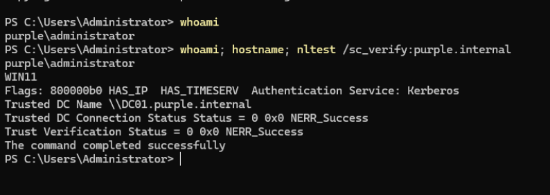
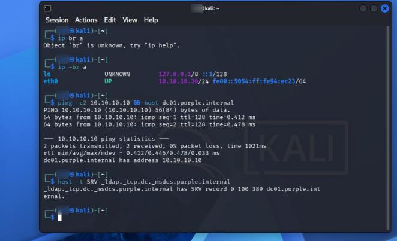

# AD Home Lab Build

## Summary

I built a small Active Directory lab on my Arch Linux laptop using KVM. It has a domain controller, a Windows 11 client joined to the domain, and a Kali box on the same network. Lots of things broke along the way, so I wrote down every problem and how I fixed it.

## Lab setup

**Host**
- Arch Linux, GNOME, ext4
- Ryzen 7 7435HS (8 cores / 16 threads), 16 GB RAM
- KVM with libvirt, QEMU and virt-manager
- Packages: `qemu-desktop libvirt virt-manager dnsmasq edk2-ovmf swtpm`
- Timeshift (rsync mode) for host snapshots

**Network**

I made a separate libvirt network called `lab` just for this. It uses NAT so the VMs can get to the internet, but nothing from outside can reach them. I turned off DHCP and libvirt's DNS on purpose. In AD the domain controller has to be the only DNS server, otherwise clients can't find the domain.

```xml
<network>
  <name>lab</name>
  <forward mode='nat'/>
  <bridge name='virbr10' stp='on' delay='0'/>
  <dns enable='no'/>
  <ip address='10.10.10.1' netmask='255.255.255.0'/>
</network>
```

**VMs**

| VM | OS | IP | DNS | RAM | Disk |
|---|---|---|---|---|---|
| DC01 | Windows Server 2025 (eval) | 10.10.10.10 | 127.0.0.1 | 3 GB | 60 GB |
| WIN11 | Windows 11 Pro | 10.10.10.20 | 10.10.10.10 | 4 GB | 80 GB |
| KALI | Kali 2026.2 | 10.10.10.30 | 10.10.10.10 | 3 GB | 60 GB |

Domain: `purple.internal` (NetBIOS `PURPLE`). I used `.internal` because it's reserved for private networks, and `.local` clashes with mDNS.

## How I built it

### 1. Host setup

```bash
sudo pacman -S qemu-desktop libvirt virt-manager dnsmasq edk2-ovmf swtpm
sudo systemctl enable --now libvirtd.service
sudo usermod -aG libvirt $USER
```

Being in the `libvirt` group means I can manage VMs without sudo. It's basically root though, since anyone in that group can make a VM that mounts host disks.

I also excluded `/var/lib/libvirt/images` from Timeshift. Otherwise every weekly snapshot would copy all the VM disks.

### 2. DC01

```bash
virt-install --connect qemu:///system --name DC01 --osinfo win2k25 \
  --memory 3072 --vcpus 2 --cpu host-passthrough --boot uefi \
  --disk size=60,bus=virtio,format=qcow2 \
  --cdrom /var/lib/libvirt/iso/<server-2025-eval>.iso \
  --disk /var/lib/libvirt/iso/virtio-win.iso,device=cdrom \
  --network network=lab,model=virtio --graphics spice --noautoconsole
```

Windows setup can't see a virtio disk, so I had to click **Load driver** and pick `viostor\2k25\amd64` from the virtio-win ISO. After install I ran `virtio-win-guest-tools.exe` to get the network driver, display driver and clipboard sharing.

Static IP, rename, then promote:

```powershell
New-NetIPAddress -InterfaceIndex (Get-NetAdapter | Where-Object Status -eq Up).ifIndex -IPAddress 10.10.10.10 -PrefixLength 24 -DefaultGateway 10.10.10.1
Set-DnsClientServerAddress -InterfaceIndex (Get-NetAdapter | Where-Object Status -eq Up).ifIndex -ServerAddresses 127.0.0.1
Rename-Computer -NewName DC01 -Restart

Install-WindowsFeature AD-Domain-Services -IncludeManagementTools
Install-ADDSForest -DomainName purple.internal -DomainNetbiosName PURPLE -InstallDns -SafeModeAdministratorPassword (Read-Host -AsSecureString "DSRM password") -Force

Add-DnsServerForwarder -IPAddress 1.1.1.1, 9.9.9.9
```

The forwarders let the DC resolve internet names. Anything in `purple.internal` it answers itself, and everything else goes out to Cloudflare or Quad9.

### 3. WIN11

Windows 11 needs TPM 2.0 and Secure Boot, so this one had a few extra flags:

```bash
virt-install --connect qemu:///system --name WIN11 --osinfo win11 \
  --memory 4096 --vcpus 2 --cpu host-passthrough \
  --boot firmware=efi,firmware.feature0.name=secure-boot,firmware.feature0.enabled=yes \
  --tpm backend.type=emulator,backend.version=2.0,model=tpm-crb \
  --disk size=80,bus=virtio,format=qcow2 \
  --cdrom /var/lib/libvirt/iso/<win11>.iso \
  --disk /var/lib/libvirt/iso/virtio-win.iso,device=cdrom \
  --network network=lab,model=virtio --graphics spice --noautoconsole
```

The TPM is software (`swtpm`). Same disk driver step as the DC, but from `viostor\w11\amd64`.

During OOBE there was no network, because there was no driver and no DHCP. I pressed **Shift+F10** and fixed it from the command prompt:

```cmd
pnputil /add-driver E:\NetKVM\w11\amd64\netkvm.inf /install
netsh int ip set addr Ethernet static 10.10.10.20 255.255.255.0 10.10.10.1
netsh interface ipv4 set dnsservers Ethernet static 10.10.10.10 primary
```

Then I went with **Set up for work or school > Sign-in options > Domain join instead** to get a local account instead of a Microsoft one.

Joined the domain:

```powershell
Add-Computer -DomainName purple.internal -NewName WIN11 -Credential PURPLE\Administrator -Restart
```

### 4. KALI

```bash
virt-install --connect qemu:///system --name KALI --osinfo debiantesting \
  --memory 3072 --vcpus 2 --cpu host-passthrough --boot uefi \
  --disk size=60,bus=virtio,format=qcow2 \
  --cdrom /var/lib/libvirt/iso/kali-linux-2026.2-installer-amd64.iso \
  --network network=lab,model=virtio --graphics spice --noautoconsole
```

Linux already has virtio drivers, so it was a normal install. DHCP fails, so I set the network manually: `10.10.10.30/24`, gateway `10.10.10.1`, DNS `10.10.10.10`. I left the domain name blank since Kali is the attacker and isn't part of the domain.

## Proving it works

WIN11 is joined and trusts the DC over Kerberos:

```powershell
whoami; hostname; nltest /sc_verify:purple.internal
```



From Kali I can find the DC the same way a domain client does, using the LDAP SRV record. This is also one of the first things an attacker would look up.

```bash
host dc01.purple.internal
host -t SRV _ldap._tcp.dc._msdcs.purple.internal
```



## Problems I hit and how I fixed them

| Problem | Why it happened | Fix |
|---|---|---|
| Couldn't set up snapper | My root was ext4, not btrfs like I thought | Used Timeshift in rsync mode instead |
| VM snapshot error: `internal snapshots of a VM with pflash based firmware require QCOW2 nvram format` | UEFI VMs keep their firmware settings in a separate NVRAM file that internal snapshots can't include | Shut the VM down and took external snapshots with `--disk-only --atomic` |
| DC01 couldn't resolve anything, but `ping 1.1.1.1` worked | ufw on the host drops forwarded traffic by default, but lets ICMP through | `sudo ufw route allow in on virbr10` (and `virbr0`) |
| `dcdiag` failed DFSREvent and SystemLog | Those tests read the last 24 hours of logs, which had normal first-boot errors after promotion | Checked the real state instead: `net share` (SYSVOL, NETLOGON) and `dcdiag /test:RidManager` |
| `Unable to find 'efi' firmware` when creating WIN11 | Arch's OVMF doesn't ship with Microsoft's Secure Boot keys enrolled | Asked for `secure-boot` only, not `enrolled-keys`. Windows 11 only needs it to be capable |
| No network in Windows 11 setup | No virtio network driver and no DHCP | Shift+F10, installed the driver with `pnputil`, set a static IP with `netsh` |
| `netsh int ip set dns` didn't work | Old syntax | `netsh interface ipv4 set dnsservers ...` |
| WIN11 couldn't ping google.com | DC01 was turned off, and it's the only DNS server | Start DC01 first, always |
| Domain login kept failing on WIN11 | I typed `PURPLE/Administrator` with a forward slash | It's a backslash: `PURPLE\Administrator`, or `administrator@purple.internal` |
| KALI powered off halfway through install | During install, virt-install makes any reboot power the VM off and ejects the ISO | Put the ISO back with `virsh change-media KALI sda <iso> --insert --config` and started it again |

## Snapshots

| VM | Snapshots |
|---|---|
| DC01 | base-pre-dc > dc-promoted > domain-joined |
| WIN11 | domain-joined |
| KALI | fresh-install |

## What I learned

- AD depends on DNS. Clients find the DC with an SRV record, so if DNS is wrong, joins and logins break even when the network is fine.
- Ping working doesn't mean the network works. A firewall can treat ICMP differently from TCP and UDP.
- Most `dcdiag` failures on a brand new DC are just noise from the first boot. Checking the actual state (shares, RID pool) tells you more.
- Windows on KVM needs virtio drivers loaded by hand, both for the disk during setup and the network after.
- UEFI changes how VM snapshots work.
- Save passwords right away. I nearly had to rebuild the DC because I thought I'd forgotten the admin password. I'd actually been typing a `/` instead of a `\` the whole time.
