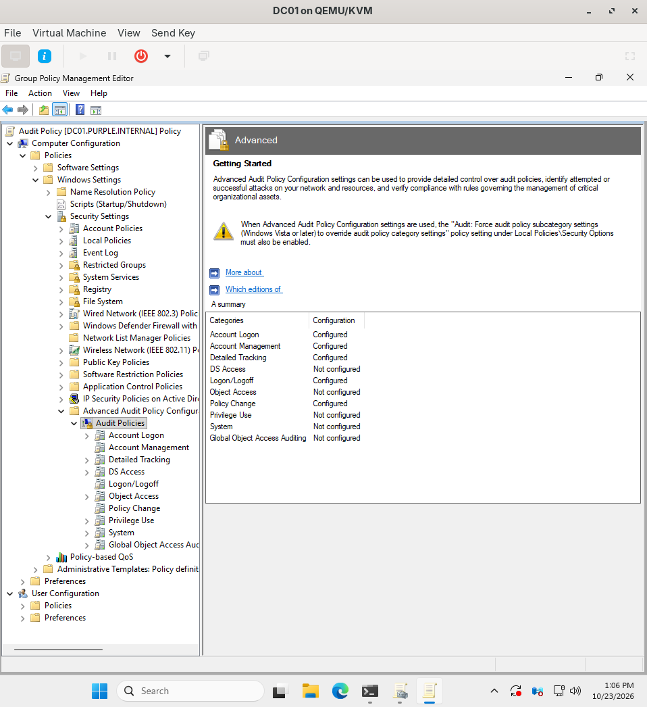
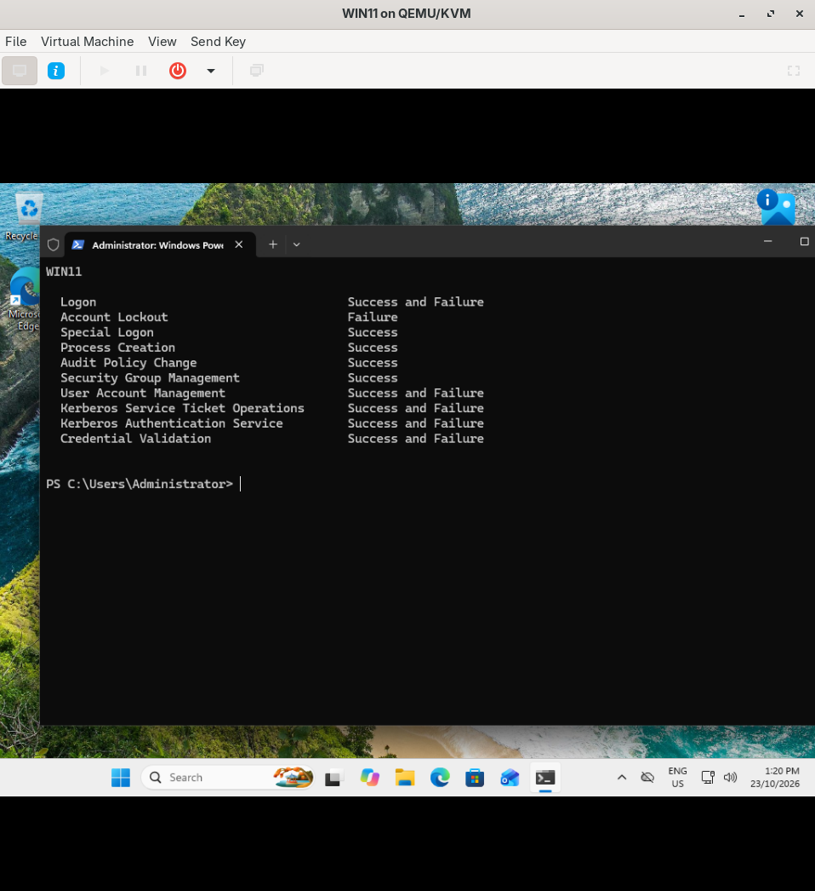
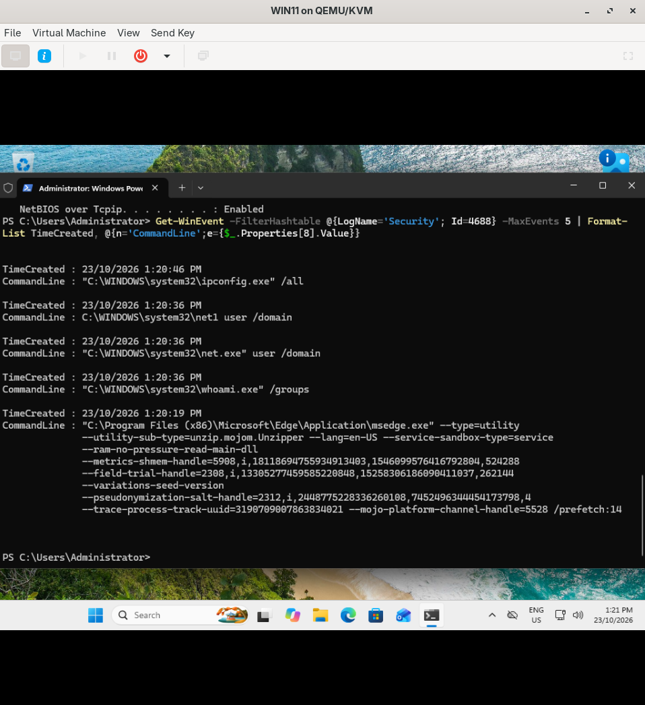
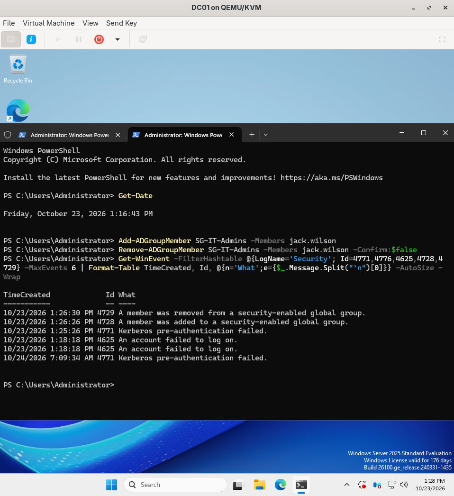

# Audit Policy: Making the Domain Log Things

## Summary

My Harbourline Freight domain was working, but it wasn't logging much that would help if something went wrong. Before I can detect anything, the machines need to record who logged in, what ran and what changed. So I made one GPO that turns on the audit settings that matter, linked it to the DC and the workstations, and then tested it by making events happen and finding them in the logs.

## Why bother

Windows doesn't log most of this by default. Process creation is off, and so is the command line. If an attacker ran commands on a workstation, there would be nothing to look at afterwards. Every detection I build later (Sysmon, Wazuh, Sigma rules) depends on these logs existing first.

## The GPO

One GPO called `Audit Policy`, linked to two places:

- `Domain Controllers`, because the DC logs every domain login and every account or group change
- `Workstations`, so WIN11 logs logins and every program that runs

```powershell
New-GPO -Name "Audit Policy" -Comment "Harbourline logging baseline"
New-GPLink -Name "Audit Policy" -Target "OU=Domain Controllers,DC=purple,DC=internal"
New-GPLink -Name "Audit Policy" -Target "OU=Workstations,OU=Harbourline,DC=purple,DC=internal"

# include the full command line in process creation events
Set-GPRegistryValue -Name "Audit Policy" -Key "HKLM\SOFTWARE\Microsoft\Windows\CurrentVersion\Policies\System\Audit" -ValueName ProcessCreationIncludeCmdLine_Enabled -Type DWord -Value 1

# use only the Advanced audit settings, not the old basic ones
Set-GPRegistryValue -Name "Audit Policy" -Key "HKLM\SYSTEM\CurrentControlSet\Control\Lsa" -ValueName SCENoApplyLegacyAuditPolicy -Type DWord -Value 1
```

Windows has two audit systems. The old one has 9 big categories, and the Advanced one has about 60 smaller subcategories. If both are set they can clash, so the second registry value tells Windows to only use the Advanced one.

The subcategories I set in the GPO editor, under Computer Configuration > Policies > Windows Settings > Security Settings > Advanced Audit Policy Configuration > Audit Policies:

| Subcategory | Logged | Main event IDs | What it tells me |
|---|---|---|---|
| Credential Validation | Success, Failure | 4776 | NTLM logins |
| Kerberos Authentication Service | Success, Failure | 4768, 4771 | Kerberos logins, and failed ones |
| Kerberos Service Ticket Operations | Success, Failure | 4769 | Service ticket requests (where Kerberoasting shows up) |
| User Account Management | Success, Failure | 4720, 4738 | Users created or changed |
| Security Group Management | Success | 4728, 4729, 4732 | Someone added to or removed from a group |
| Process Creation | Success | 4688 | Every program that runs, with its command line |
| Logon | Success, Failure | 4624, 4625 | Logins and failed logins |
| Account Lockout | Failure | 4740 | Accounts getting locked |
| Special Logon | Success | 4672 | Admin-level logins |
| Audit Policy Change | Success | 4719 | Someone changing the logging itself |



I left the rest off for now. More logging isn't always better, it just means more noise to dig through.

## Checking it applied

The GPO is only the instruction. `auditpol` shows what Windows is really doing, so I checked that on both machines after `gpupdate /force`.

```powershell
auditpol /get /category:* | Select-String "Success|Failure"
```



## Testing it

### Process creation on WIN11

I ran a few commands an attacker might run first, then pulled the 4688 events:

```powershell
whoami /groups
net user /domain
ipconfig /all

Get-WinEvent -FilterHashtable @{LogName='Security'; Id=4688} -MaxEvents 5 | Format-List TimeCreated, @{n='CommandLine';e={$_.Properties[8].Value}}
```



Every command is there with its exact arguments. One thing I noticed: I ran `net user /domain` once but got two events, `net.exe` and `net1.exe`. `net.exe` hands the work to `net1.exe`. Attackers sometimes run `net1` directly to get past rules that only look for `net.exe`, so a detection has to look for both.

### Failed login and group change on DC01

From WIN11 I tried to map a share as Jack with a wrong password, once. Then on the DC I added Jack to `SG-IT-Admins` and removed him straight away.

```powershell
Add-ADGroupMember SG-IT-Admins -Members jack.wilson
Remove-ADGroupMember SG-IT-Admins -Members jack.wilson -Confirm:$false

Get-WinEvent -FilterHashtable @{LogName='Security'; Id=4771,4776,4625,4728,4729} -MaxEvents 6 | Format-Table TimeCreated, Id, @{n='What';e={$_.Message.Split("`n")[0]}} -AutoSize -Wrap
```



- 4728 and 4729: Jack added to and removed from IT-Admins. Added to an admin group and removed a minute later is a classic sign of someone covering their tracks.
- 4771: my wrong password. Windows tried Kerberos first, so it showed up as a Kerberos pre-auth failure, not NTLM.
- 4625: failed logons from WIN11 while the clocks were still wrong (see below).

The bottom 4771 is dated the next day. That's not a typo, it's from when I accidentally pushed the DC's clock 18 hours forward. It's actually the oldest event, it just has the wrong time on it.

## Problems I hit

| Problem | Why | Fix |
|---|---|---|
| All settings showed "Not configured" after I thought I'd set them | I had opened the `Default Domain Policy` in the editor, not `Audit Policy` | In GPMC, expanded Group Policy Objects, right-clicked `Audit Policy` > Edit, and checked the name at the top of the editor |
| `gpme.msc /gpobject:...` gave "The parameter is incorrect" | The long command broke over two lines when I pasted it | Used GPMC instead |
| Detailed Tracking still "Not configured" | I missed Process Creation | Set it and checked the summary again |
| `gpupdate` on WIN11: computer policy failed, clock not synchronized | DC01 was on Pacific time and WIN11 on Sydney time, 18 hours apart. Kerberos won't work if clocks are more than 5 minutes apart | Set DC01 to `AUS Eastern Standard Time` and pointed it at NTP servers |
| DC01 still showed the wrong date in PowerShell after the fix | PowerShell reads the time zone when the window opens, so it was still showing Pacific time. The taskbar clock was right | Opened a new PowerShell window |
| An event on the DC is dated the next day | I ran `Set-Date` in that old PowerShell window, which pushed the clock 18 hours forward until NTP fixed it | Nothing to fix now, but it's a good example of why clocks matter for logs |

The time fix on DC01:

```powershell
tzutil /s "AUS Eastern Standard Time"
w32tm /config /manualpeerlist:"time.cloudflare.com,0x8 au.pool.ntp.org,0x8" /syncfromflags:manual /reliable:yes /update
Restart-Service w32time; w32tm /resync /force
w32tm /query /source
```

And to check WIN11 against the DC:

```powershell
w32tm /stripchart /computer:dc01.purple.internal /samples:3 /dataonly
```

## What I learned

- Windows doesn't log most useful things by default. You have to turn it on.
- Check what's really applied (`auditpol`), not just what the GPO says.
- Always check which GPO you're editing. The name is at the top of the editor.
- Kerberos needs clocks within 5 minutes. A time zone mismatch was enough to break Group Policy.
- The DC is the time source for the domain, so its clock has to be right.
- If a clock is wrong, the log timeline is wrong too. That's why NTP matters so much for investigations.
- `net.exe` runs `net1.exe` behind the scenes, so detections need to cover both.
