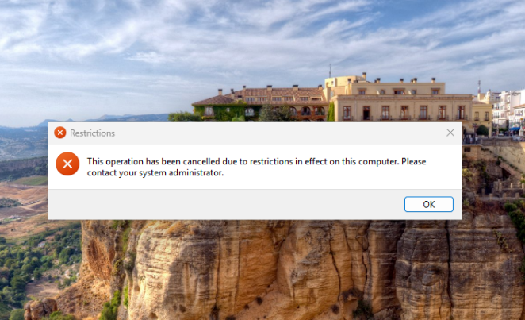
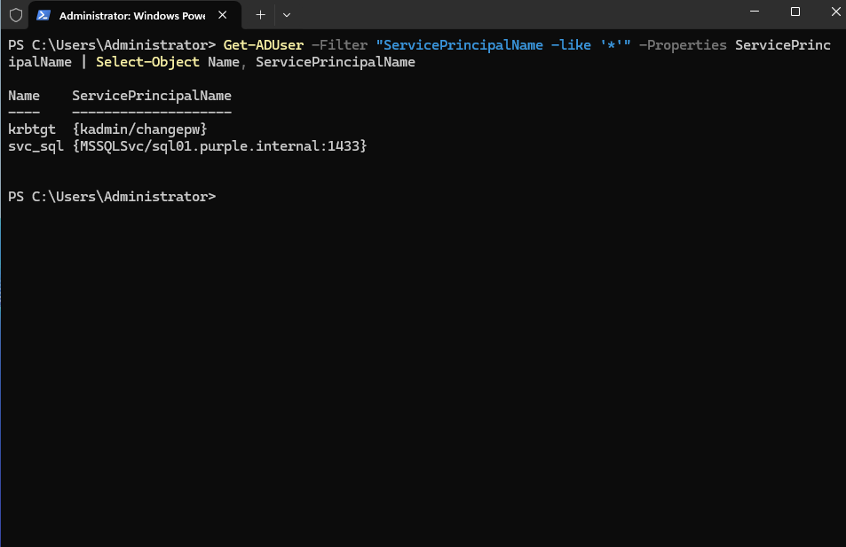

# Domain Structure: Harbourline Freight

## Summary

After building the lab I turned `purple.internal` into a small fake company called Harbourline Freight. It has departments, staff, groups, a few Group Policies and a service account. An empty domain isn't much use for practice, and this gives me something realistic to attack and defend later.

## OUs

```
purple.internal
└── Harbourline
    ├── IT
    ├── HR
    ├── Finance
    ├── Sales
    ├── Groups
    ├── Workstations
    └── Service Accounts
```

I made my own OUs because the built-in `Users` and `Computers` folders are containers, not OUs, and you can't link a GPO to a container. Every real domain has its own OU layout for this reason.

I also ran `redircmp` so any new computer that joins the domain lands in `Workstations` straight away, instead of sitting in `Computers` with no policies.

```powershell
New-ADOrganizationalUnit -Name "Harbourline" -Path "DC=purple,DC=internal"
"IT","HR","Finance","Sales","Groups","Workstations","Service Accounts" | ForEach-Object { New-ADOrganizationalUnit -Name $_ -Path "OU=Harbourline,DC=purple,DC=internal" }
redircmp "OU=Workstations,OU=Harbourline,DC=purple,DC=internal"
```

## Users

12 staff, with usernames in `first.last` format. Each one has a title, department and company set, like a real HR-fed directory.

| Department | Name | Title |
|---|---|---|
| IT | Liam Nguyen | IT Manager |
| IT | Priya Sharma | Systems Administrator |
| IT | Jack Wilson | Helpdesk Technician |
| HR | Sarah Mitchell | HR Manager |
| HR | Ahmed Hassan | HR Officer |
| Finance | David Chen | Finance Manager |
| Finance | Emily Taylor | Accountant |
| Finance | Olivia Brown | Payroll Officer |
| Sales | James Murphy | Sales Manager |
| Sales | Chloe Williams | Account Executive |
| Sales | Daniel Kim | Sales Representative |
| Sales | Mia Robinson | Sales Representative |

## Groups

All Global security groups, kept in the `Groups` OU.

| Group | Members |
|---|---|
| SG-IT | Liam, Priya, Jack |
| SG-HR | Sarah, Ahmed |
| SG-Finance | David, Emily, Olivia |
| SG-Sales | James, Chloe, Daniel, Mia |
| SG-IT-Admins | Liam, Priya |

Jack is in IT but not in IT-Admins on purpose. Helpdesk usually doesn't get full admin.

## Group Policy

| GPO | Linked to | What it does |
|---|---|---|
| Default Domain Policy | Domain root | 12+ character complex passwords, 90 day expiry, lockout after 5 bad tries for 15 minutes |
| WS - Login Banner | Workstations | Shows an "Authorised Use Only" notice before login |
| USR - No Control Panel (non-IT) | HR, Finance, Sales | Blocks Control Panel and Settings for non-IT staff |

The password policy has to be in a GPO at the domain root. If you link it to an OU it does nothing for domain accounts.

Computer settings follow where the computer is, and user settings follow where the user is. That's why the banner is linked to `Workstations` and the Control Panel block is linked to the department OUs.

```powershell
Set-ADDefaultDomainPasswordPolicy -Identity purple.internal -MinPasswordLength 12 -ComplexityEnabled $true -MaxPasswordAge 90.00:00:00 -LockoutThreshold 5 -LockoutDuration 00:15:00 -LockoutObservationWindow 00:15:00

New-GPO -Name "WS - Login Banner" | New-GPLink -Target "OU=Workstations,OU=Harbourline,DC=purple,DC=internal"
Set-GPRegistryValue -Name "WS - Login Banner" -Key "HKLM\SOFTWARE\Microsoft\Windows\CurrentVersion\Policies\System" -ValueName LegalNoticeCaption -Type String -Value "Harbourline Freight: Authorised Use Only"

New-GPO -Name "USR - No Control Panel (non-IT)"
"HR","Finance","Sales" | ForEach-Object { New-GPLink -Name "USR - No Control Panel (non-IT)" -Target "OU=$_,OU=Harbourline,DC=purple,DC=internal" }
Set-GPRegistryValue -Name "USR - No Control Panel (non-IT)" -Key "HKCU\Software\Microsoft\Windows\CurrentVersion\Policies\Explorer" -ValueName NoControlPanel -Type DWord -Value 1
```

### Checking it worked

On WIN11 I ran `gpupdate /force` and `gpresult /r`. The banner showed up before login:


Logged in as a Sales user, Control Panel was blocked:



The Settings app doesn't show an error, it just doesn't open. That's normal for this policy. Logged in as Jack from IT, Control Panel opened fine.

## Service account

`svc_sql` sits in the `Service Accounts` OU, with an SPN for a SQL Server and a password that never expires. That's a very common setup in real companies, and it's what makes Kerberoasting possible. Any domain user can request a ticket for an SPN, and that ticket is encrypted with the service account's password hash, so it can be cracked offline.

```powershell
Set-ADUser svc_sql -ServicePrincipalNames @{Add="MSSQLSvc/sql01.purple.internal:1433"}
Get-ADUser -Filter "ServicePrincipalName -like '*'" -Properties ServicePrincipalName | Select-Object Name, ServicePrincipalName
```



`krbtgt` shows up too. It's the built-in account the DC uses to sign Kerberos tickets.

## Problems I hit

| Problem | Why | Fix |
|---|---|---|
| `New-ADUser` failed with a password error, then said "already exists" when I ran it again | It creates the account first and sets the password second. When the password fails, the account is left disabled with no password | `Set-ADAccountPassword -Reset` and `Enable-ADAccount` on the existing account instead of making it again |
| UAC asked for an admin username and password when Jack opened Terminal (Admin) | Jack is a standard user, so UAC asks for admin credentials instead of just Yes/No | Expected. Used a normal Terminal for his checks |
| WIN11 wouldn't shut down from the host | A logged-in session with open windows blocked the shutdown signal | Shut down from inside Windows |

## What I learned

- You can't link GPOs to the default `Users` and `Computers` containers. You need real OUs.
- Computer policy follows the computer and user policy follows the user.
- The domain password policy only works from the domain root.
- A failed `New-ADUser` can still leave an account behind. Check before running it again.
- Service accounts with SPNs and old passwords are a big target, and now I know why.

Next: [audit-policy.md](audit-policy.md) for how I turned on logging across the domain.
