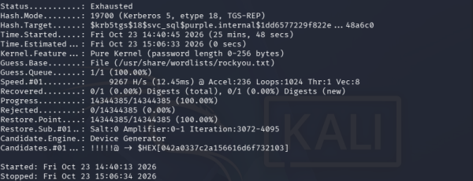

# Kerberoasting: Attack and Detect

## Summary

This is my first full purple-team loop: run an attack from Kali, then catch it in the logs I set up earlier, then harden against it. The target is `svc_sql`, the service account with an SPN. Any domain user can ask the DC for that account's service ticket, which is encrypted with the account's password hash, so it can be taken offline and attacked. The interesting part wasn't the attack, it was everything my modern lab did to get in the way of it.

## The idea

A service account with an SPN (here `MSSQLSvc/sql01.purple.internal:1433`) can be Kerberoasted:

1. Any domain user asks the DC for a service ticket (TGS) for that SPN.
2. The ticket is encrypted with the service account's password hash.
3. The attacker takes the ticket offline and tries passwords against it until one works.

No admin rights needed. That's why service accounts with weak passwords are such a common way in. MITRE ATT&CK calls this T1558.003.

## What my lab fought back with

I expected this to be quick. It wasn't, and every roadblock was a real security control doing its job.

### RC4 is dead on Server 2025

The classic attack uses RC4, because an RC4 ticket (`$krb5tgs$23$`) is faster to crack and easy to spot. I tried it with impacket:

```bash
impacket-GetUserSPNs -dc-ip 10.10.10.10 purple.internal/jack.wilson -request
```

Every time it failed with `KDC_ERR_ETYPE_NOSUPP`. My Windows Server 2025 DC refuses to issue RC4 tickets. I even tried to force it: set the account to allow RC4, then enabled RC4 at the KDC in the registry. The KDC still refused. RC4 is hard-disabled in this version, which is a good default I didn't have to configure.

impacket's `GetUserSPNs` only knows how to ask for RC4, so on an AES-only domain it's a dead end.

### Roasting AES instead

The modern way is to roast the AES ticket. I used Rubeus on the Windows 11 client:

```powershell
# Defender quarantines Rubeus, so exclude the folder first (this itself logs Event 5007)
Add-MpPreference -ExclusionPath C:\Tools\Rubeus
.\Rubeus.exe kerberoast /user:svc_sql /nowrap
```

That returned an AES256 ticket (`$krb5tgs$18$`). The `18` is the tell: this is AES256, not the RC4 `23` every tutorial shows.

### The crack failed, and that's the point

I moved the hash to Kali and ran it against rockyou (hashcat mode 19700, on CPU since the VM has no GPU):

```bash
hashcat -m 19700 svc_sql.hash /usr/share/wordlists/rockyou.txt
```

It ran through all 14 million words and found nothing. `Status: Exhausted`.



That's because of a control I set up on day one: the Default Domain Policy forces 12-character complex passwords. `svc_sql`'s password was never going to be in a common wordlist. The password policy defended against the offline crack.

## The detection

The Rubeus request generated the detection event on the DC. On DC01:

```powershell
Get-WinEvent -FilterHashtable @{LogName='Security'; Id=4769} -MaxEvents 10 | Where-Object { $_.Message -match 'svc_sql' } | Format-Table TimeCreated, @{n='Enc';e={($_.Message -split "`n" | Select-String 'Ticket Encryption Type').ToString().Trim()}} -AutoSize
```

The Ticket Encryption Type comes back as **0x12 (AES256)**.

This is the big lesson. Almost every Kerberoasting detection, in tutorials and in real SIEMs, alerts on **0x17 (RC4)**, because that used to be the obvious sign. My attack shows up as **0x12**, so a rule that only watches for 0x17 would miss it entirely.

On a modern AES domain you can't detect Kerberoasting by encryption type alone. The better signals are behavioural:

- one account requesting service tickets for many different SPNs in a short window
- a service account's ticket being requested from a workstation that has no reason to
- a spike in 4769 volume from one source

## Mitigations

| Control | Why it helps | In my lab |
|---|---|---|
| Strong password policy | Makes the offline crack useless | 12-char complex policy stopped the rockyou crack |
| AES only, no RC4 | Removes the fast, obvious attack path | Server 2025 default, I couldn't even turn RC4 back on |
| gMSA for service accounts | Windows manages a 120-char password that can't be cracked | Noted for later |
| Behavioural detection | Catches the attack when encryption type won't | 4769 by volume and source, not just 0x17 |

## What I learned

- Kerberoasting needs no special rights. Any domain user can pull the ticket.
- Server 2025 kills RC4 by default. The classic RC4 attack and the classic 0x17 detection are both out of date against it.
- The encryption type in the hash (`18` vs `23`) and in the 4769 event (`0x12` vs `0x17`) tells you which cipher was used.
- A good password policy beats the crack even after the attacker has the ticket.
- Detecting by encryption type isn't enough on an AES domain. You have to look at behaviour.
- Everything the attacker does leaves a trail: the Defender exclusion (5007), the ticket request (4769), the tools running (Sysmon 1).

## Cleanup

After the exercise I put the lab back: removed the RC4 registry allowance, restarted the KDC, and set `svc_sql` back to AES only. I deleted the ticket file from Kali so no crackable material was left lying around.
