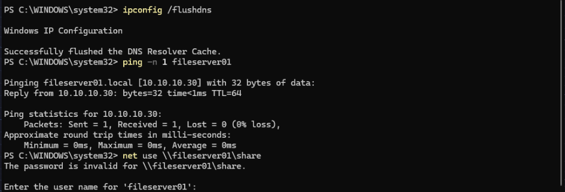
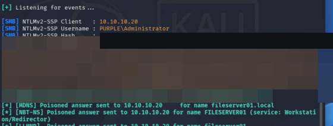
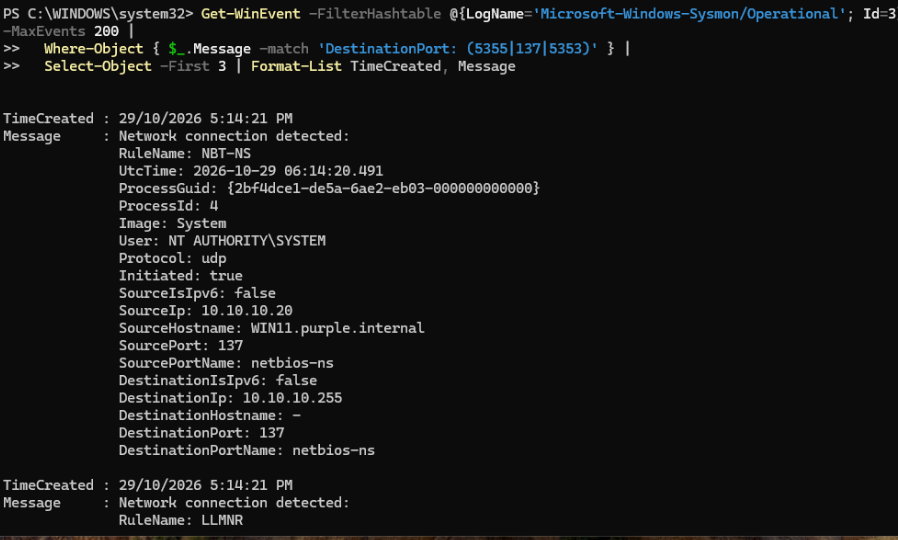
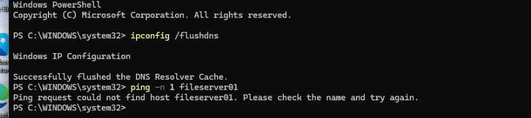

# LLMNR, NBT-NS and mDNS Poisoning: Attack, Detect, Harden

## Summary

My second full purple-team loop. I poisoned name resolution in the lab with Responder, captured a password hash off the Windows 11 client, found the attack in my logs, and then hardened the client until the attack stopped working. The best part was watching the attack die one protocol at a time, and finding that disabling the two usual suspects wasn't enough.

## The idea

When a Windows machine can't resolve a name through DNS, it doesn't give up. It falls back to shouting the name on the local network and trusting whoever answers:

- LLMNR (UDP 5355)
- NBT-NS (UDP 137)
- mDNS (UDP 5353, for `.local` names)

There's no authentication on any of these. Any machine on the segment can answer "yes, that's me" and the victim believes it. Responder does exactly that. When the victim then tries to connect, it authenticates to the attacker and hands over a Net-NTLMv2 hash. MITRE ATT&CK calls this T1557.001.

In my lab:

- Kali (`10.10.10.30`) runs Responder.
- Windows 11 (`10.10.10.20`, domain `purple.internal`) is the victim.
- Everything is on an isolated NAT network, so no real machines are touched.

## The attack

First I watched without answering, to confirm the victim was broadcasting:

```bash
sudo responder -I eth0 -A
```

Then on Windows 11 I looked up a host that doesn't exist:

```powershell
Test-Connection fileserver01 -Count 1
```

Responder logged the client asking for `fileserver01` over MDNS, LLMNR and NBT-NS. All three were live.

Then I turned poisoning on:

```bash
sudo responder -I eth0
```

and on Windows 11 touched a share on the fake host, which forces an SMB authentication:

```powershell
ls \\fileserver01\share
```

Responder answered the name, the client connected to Kali and authenticated, and I had a Net-NTLMv2 hash for the account logged into the box (here the domain Administrator).





That hash is hashcat mode 5600. With a weak password it cracks offline. My 12-character domain password policy would stop that, same as it did with Kerberoasting.

### A few things that tripped me up

- **IPv6 won first.** Windows preferred the IPv6 / mDNS answer, so my first attempts resolved over IPv6 and Responder didn't log the hash. I disabled IPv6 on the client NIC to force IPv4, and then the capture landed. On a real network you'd have to deal with IPv6 too, not just turn it off.
- **IPC$ is a trap.** Touching `\\fileserver01\ipc$` gave a null session, so Windows never sent a hash and just prompted for a username. A normal share name forces real authentication, which is what gets captured.

## The detection

This is where it got interesting.

My Sigma rule for this attack (`llmnr_nbtns_poisoning.yml` in my detection-rules repo) watches Sysmon Event 3 (network connection) for UDP going to port 5355 or 137. So I looked for those events:

```powershell
Get-WinEvent -FilterHashtable @{LogName='Microsoft-Windows-Sysmon/Operational'; Id=3} -MaxEvents 1000 |
  Where-Object { $_.Message -match 'DestinationPort:\s*(5355|137)' }
```

Nothing. Zero. So I checked whether the sensor logs UDP at all:

```powershell
... | Where-Object { $_.Message -match 'Protocol: udp' } | Measure-Object   # Count: 0
```

Count was 0. My Sysmon config (SwiftOnSecurity) logs no UDP, full stop. So my rule was pointed at telemetry the sensor was throwing away. The detection logic was fine, the sensor just wasn't feeding it. That is the main lesson of this write-up: a rule is only as good as the data under it.

Two things did catch the attack with the config as it was:

- **Event 3, the rogue SMB.** The client made an outbound SMB (445) connection to `10.10.10.30`, a box that is not a file server and that nothing should ever connect to.
- **Event 22, the bad name.** The DNS Client logged `fileserver01` resolving to the attacker's IP. A bare single-label name with no DNS record coming back as an endpoint IP is a strong signal on its own.

### Fixing the sensor

To make the rule work, I added the three name-resolution ports to the NetworkConnect include block in the Sysmon config:

```xml
<DestinationPort name="LLMNR"  condition="is">5355</DestinationPort>
<DestinationPort name="NBT-NS" condition="is">137</DestinationPort>
<DestinationPort name="mDNS"   condition="is">5353</DestinationPort>
```

Reloaded with `Sysmon64 -c`, ran the lookup again, and the broadcasts now show up with the right fields: `Protocol: udp`, `Initiated: true`, `DestinationPort: 5355/137`, tagged with my RuleName.



So the rule went from blind, to "found the gap", to firing on real poisoning traffic.

## Hardening

The fix is to stop the client from falling back to these protocols at all. I did it with a GPO plus two registry settings, and re-ran the attack after each change.

- **LLMNR:** GPO at Computer Configuration > Policies > Administrative Templates > Network > DNS Client > **Turn off multicast name resolution** = Enabled. (Sets `EnableMulticast = 0`.)
- **NBT-NS:** set `NetbiosOptions = 2` on every interface. There is no clean legacy GPO toggle for this, which is worth knowing.
- **mDNS:** set `EnableMDNS = 0` under the Dnscache service.

Watching Responder after each step was the interesting part. With LLMNR and NBT-NS off, Responder stopped answering those two, but the attack still worked. It had fallen through to mDNS: `fileserver01.local` still resolved to Kali. mDNS is the third name-resolution protocol that most "disable LLMNR and NBT-NS" guides forget about.

Only after I disabled mDNS as well did the attack finally die. The client couldn't resolve `fileserver01` at all:



## MITRE ATT&CK

| Tactic | Technique | ID |
|---|---|---|
| Credential Access | LLMNR/NBT-NS Poisoning and SMB Relay | T1557.001 |

## Mitigations

| Control | Why it helps | In my lab |
|---|---|---|
| Disable LLMNR | Removes the first fallback | GPO, `EnableMulticast = 0` |
| Disable NBT-NS | Removes the second fallback | `NetbiosOptions = 2` per interface |
| Disable mDNS | Removes the forgotten third fallback | `EnableMDNS = 0` |
| Strong password policy | Makes a captured hash useless offline | 12-char complex policy |
| SMB signing | Blocks the relay version of this attack | Noted for later |
| Log the right telemetry | A rule is useless if the sensor drops the data | Added UDP 5355/137/5353 to Sysmon |

## What I learned

- Name resolution falls back to three protocols, not one. Disabling LLMNR and NBT-NS is not enough. mDNS will still poison.
- The attack grabs the logged-in user's Net-NTLMv2 hash just from touching a bad share name. No clicks, no payload.
- A detection rule is only as good as the telemetry under it. Mine was blind because the Sysmon config logged no UDP.
- Detecting by effect is often stronger: the rogue SMB connection (Event 3) and the bad name resolution (Event 22) caught the attack even when the broadcast rule couldn't.
- IPv6 and IPC$ both quietly broke my first capture attempts. The tooling details matter.

## Cleanup

I left LLMNR, NBT-NS and mDNS disabled on the client, since that is the whole point. I kept the Sysmon config change so the telemetry stays. I re-enabled IPv6 on the NIC, and deleted the captured hash from Kali so nothing crackable was left lying around.

Next: [wazuh.md](wazuh.md) for adding a Wazuh SIEM and custom detection rules.
