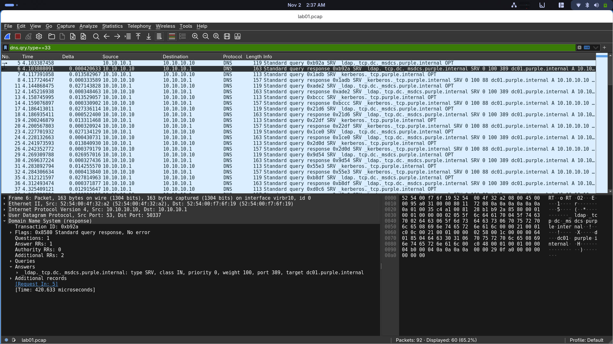
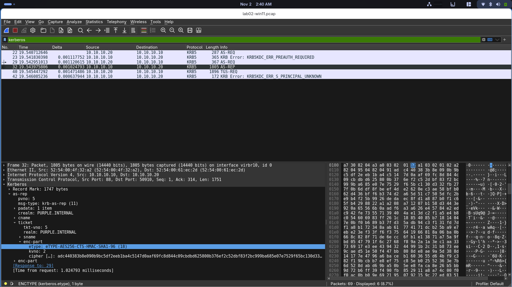
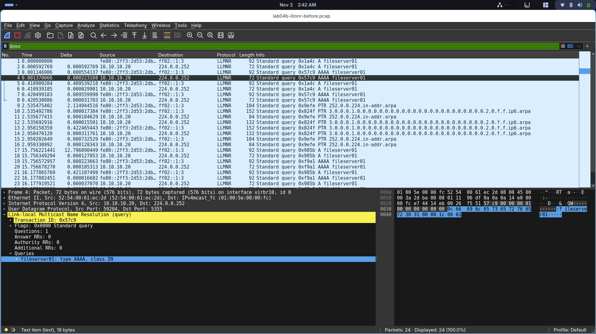
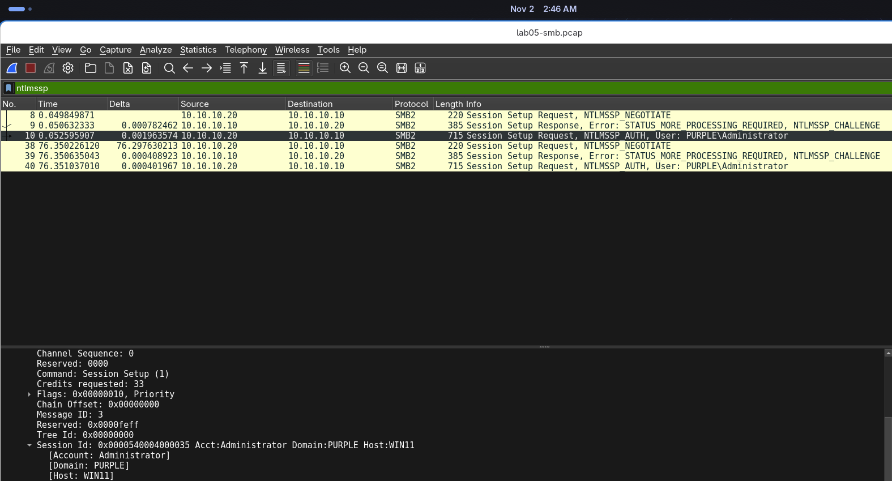
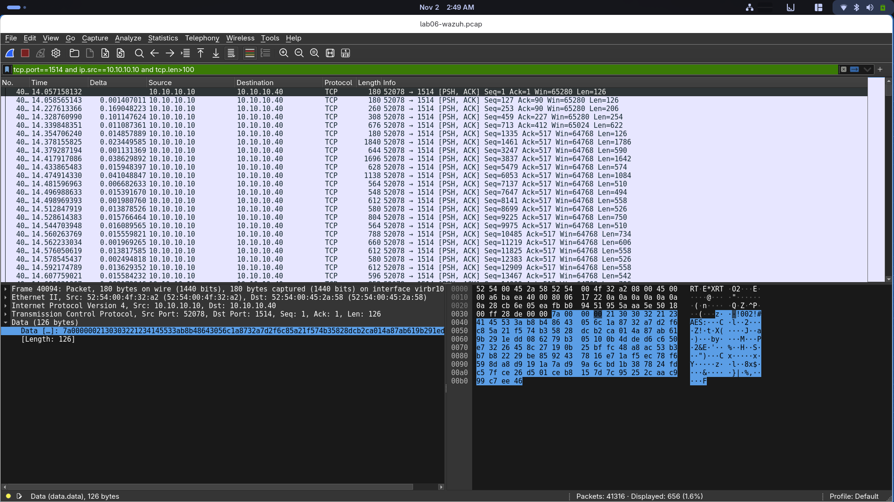

# Reading My Own Lab on the Wire: DNS, Kerberos, LLMNR, NTLM and Wazuh

## Summary

I put Wireshark on my lab network and watched the traffic my own attacks and
logins make. This write-up walks through five things I captured: how a client
finds the domain controller, a full Kerberos login, LLMNR before and after
hardening, the NTLM handshake, and the Wazuh agent talking to its manager. The
point was to see on the wire what I had only seen in logs before, and to link
the two halves of the lab together.

## Lab setup

- Arch Linux host, KVM. All the VMs share one isolated NAT network on the bridge
  `virbr10`, so I can capture every packet in the lab from one spot on the host.
  No need to install anything inside the VMs.
- Wireshark on the host. Capture without root by joining the `wireshark` group,
  which puts a capability on `dumpcap`.
- VMs: DC01 (Windows Server 2025, DNS + KDC, `10.10.10.10`), WIN11 (domain
  client, `10.10.10.20`), Wazuh (Ubuntu, manager, `10.10.10.40`).

```
# capture on the lab bridge
tshark -i virbr10 -n -w out.pcap
```

One thing that cost me two captures: tshark takes about a second to start, so if
I fire the traffic too early I catch nothing. Start the capture first, then make
the traffic.

## 1. How a client finds the domain controller

I had written before that Active Directory runs on DNS, but I had never seen it.
On WIN11:

```
ipconfig /flushdns
nltest /dsgetdc:purple.internal /force
```

The `/force` matters. Without it the answer comes straight from the client's DC
locator cache and nothing crosses the wire. With it, WIN11 asks DNS properly:

```
WIN11 -> DC01   SRV _ldap._tcp.dc._msdcs.purple.internal
DC01  -> WIN11  SRV 0 100 389 dc01.purple.internal   A 10.10.10.10
WIN11 -> DC01   SRV _kerberos._tcp.purple.internal
DC01  -> WIN11  SRV 0 100 88  dc01.purple.internal    A 10.10.10.10
```

Read the SRV answer left to right: priority, weight, **port**, then the target
host. The client starts off knowing only the string `purple.internal` and walks
away with a hostname, a port and an IP. The A record is glued into the same
response, so it does not even need a second lookup. The `_ldap` record points at
port 389, the `_kerberos` record at port 88, both on DC01. That is how the
client knows where to send LDAP queries and where to send ticket requests.

This is also exactly why a wrong DNS setting breaks logins while ping still
works. Ping does not need these records. The domain join does.



## 2. A Kerberos login on the wire

Next I watched a Kerberos exchange. On WIN11:

```
klist purge
klist get MSSQLSvc/DC01.purple.internal:1433
```

The capture:

```
KRB5  AS-REQ
KRB5  KRB5KDC_ERR_PREAUTH_REQUIRED
KRB5  AS-REQ      (again)
KRB5  AS-REP      <- the TGT
KRB5  TGS-REQ
KRB5  KRB5KDC_ERR_S_PRINCIPAL_UNKNOWN
```

Two things stood out.

First, the pre-auth dance. The first AS-REQ gets rejected on purpose with
PREAUTH_REQUIRED. The client then re-sends it with an encrypted timestamp to
prove it knows the password. Accounts that have pre-auth turned off skip this
step, and that is the whole basis of AS-REP roasting: the KDC hands back
crackable material without the client ever proving anything. Everything in my
lab had pre-auth on, which is the safe default.

Second, the encryption type. I looked at the `etype` field across the exchange
and it was 18 the whole way through. Type 18 is AES256, which is the same `0x12`
I saw in the 4769 event when I Kerberoasted `svc_sql`. The client offered RC4
(type 23) as an option but Server 2025 never used it. Same fact I found during
the Kerberoasting write-up, this time seen on the network instead of in a log.
It is a good reminder that an RC4-only detection would miss this.

The TGS request errored with S_PRINCIPAL_UNKNOWN because that exact SPN is not
registered, but the request still went out and got captured, which was the
point.



## 3. LLMNR, before and after hardening

In my LLMNR write-up I disabled LLMNR, NBT-NS and mDNS by GPO. Here I got to see
both sides of that on the wire.

First with the hardening on. I started a capture on ports 5355, 137 and 5353 and
ran `ping fileserver01` (a name that does not exist). Result: zero packets.
WIN11 asked DNS, got NXDOMAIN, and gave up. No broadcast, nothing for an attacker
to answer.

Then I turned LLMNR back on just to see the difference:

```
# WIN11, admin PowerShell
Set-ItemProperty "HKLM:\Software\Policies\Microsoft\Windows NT\DNSClient" -Name EnableMulticast -Value 1
ping fileserver01
```

This time, 24 packets:

```
fe80::...     -> ff02::1:3     LLMNR query A  fileserver01   (IPv6 multicast)
10.10.10.20   -> 224.0.0.252   LLMNR query A  fileserver01   (IPv4 multicast)
```

After DNS fails, the client shouts the name to the whole subnet. There is no
authentication and no verification. Any machine on the segment can answer and
claim to be `fileserver01`, which is exactly what Responder does. It just replies
first and the victim believes it.

I also noticed the IPv6 query goes out before the IPv4 one. That lines up with a
problem I hit during the actual attack, where Windows preferred the IPv6 answer
and Responder caught nothing until I disabled IPv6 on the NIC.

Then I set `EnableMulticast` back to 0 to re-harden. Same ping, opposite result:
24 packets with it on, 0 with it off. That pair is the proof the hardening works.



## 4. The NTLM handshake

To see NTLM I connected from WIN11 to a share on DC01 **by IP address**:

```
net use \\10.10.10.10\SYSVOL
```

Connecting by IP forces NTLM. If I had used the name `\\DC01.purple.internal` it
would have used Kerberos instead. I entered `PURPLE\Administrator` at the prompt.

The capture shows the NTLMSSP three-message handshake:

```
0x1  Negotiate      client: "I support NTLM"
0x2  Challenge      server: a random nonce
0x3  Authenticate   client: PURPLE\Administrator + the response
```

That third message carries the Net-NTLMv2 response, which is an HMAC over the
server's challenge plus a client blob. It is the same thing Responder captured
during the LLMNR attack. The only difference is who sends the challenge. Here
DC01 is the real server. With Responder, the attacker is the server, so it sends
its own challenge, logs the response, and cracks it offline. Because the response
is salted by the challenge, you have to crack it, you cannot replay it directly.

The SMB dialect negotiated was 3.1.1. I also saw status
STATUS_MORE_PROCESSING_REQUIRED on the first session setup, which looks like an
error but is normal. It is the server saying "got your negotiate, here is the
challenge, keep going", and then success on the authenticate.



## 5. The Wazuh agent on the wire

Last one. I wanted to know whether the agent to manager traffic is encrypted,
because all my detection data flows over it. I shut WIN11 first to free RAM
(running four VMs at once swapped the host last time), started the Wazuh VM, and
let DC01's agent reconnect on its own.

```
DC01 (10.10.10.10)  ->  Wazuh (10.10.10.40)   on TCP 1514
```

On reconnect the agent flushed its buffered logs, so I caught about 780 KB in ten
seconds. Port 1515 (enrollment) did not fire, because the agent was already
enrolled. Enrollment is a first-time thing, reconnect uses 1514.

The payload starts with a plaintext marker and then turns to noise:

```
... ! 0 0 2 ! # A E S : <ciphertext> ...
```

So the agent tags the cipher in the clear but encrypts everything after with AES.
I grepped the whole stream for event keywords like sysmon, event and admin, and
got nothing. No log content leaks on the wire.

That answered my question. The agent link is AES-encrypted by default. A sniffer
on the segment sees only ciphertext, even though the 4769s, the Sysmon events and
the whole `svc_sql` roast flow over this exact link. The weak point is the agent
key file, not the network.



## What I learned

- Active Directory discovery is just DNS SRV records, and I can watch a client
  go from a domain name to a hostname, a port and an IP in four packets.
- Kerberos pre-auth is the rejection-then-retry at the start of every login, and
  turning it off is what makes an account AS-REP roastable.
- The AES256 I saw as `0x12` in the 4769 event is `etype 18` on the wire. Same
  fact, two places.
- LLMNR poisoning is possible because the client broadcasts a name to the whole
  subnet with no way to check who answers. With the GPO hardening on, that
  broadcast simply never happens.
- The Net-NTLMv2 hash Responder steals is just the normal NTLM authenticate
  message. The attack is making the victim send it to you instead of the real
  server.
- Almost everything in the lab is readable on the wire. DNS, Kerberos pre-auth,
  LLMNR and NTLM are all in the clear, and the NTLM response is even crackable.
  The one thing that is encrypted is the SIEM's own telemetry, which makes sense
  because those logs describe every attack.
- Capture on the host at the bridge, not inside each VM. One capture point sees
  the whole segment.

## A note on the captures

The packet captures hold real hashes and ticket material from my lab accounts,
so they stay off the public repo. Only cropped screenshots with the sensitive
bytes removed go in, the same way I redacted the Responder hash in the LLMNR
write-up.
