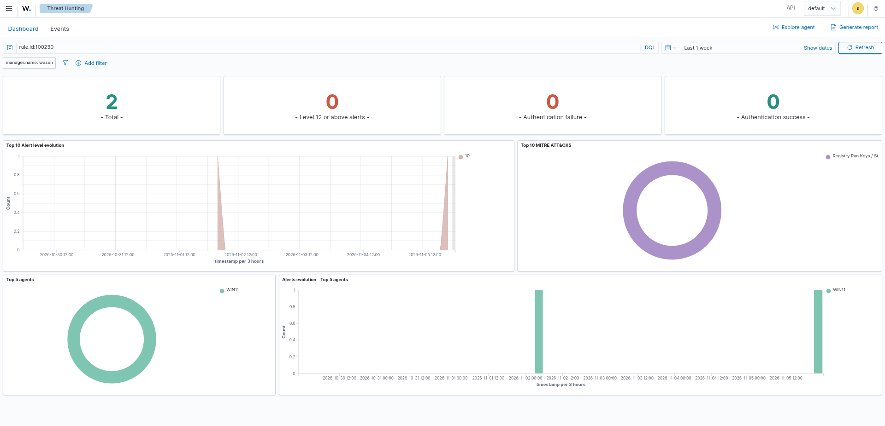
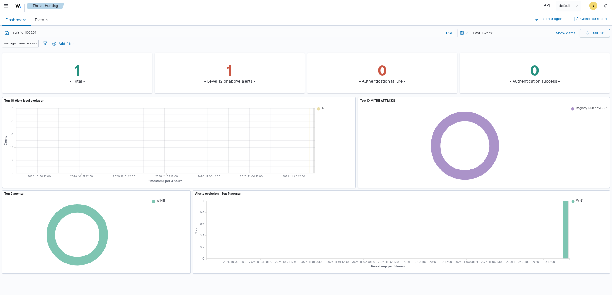
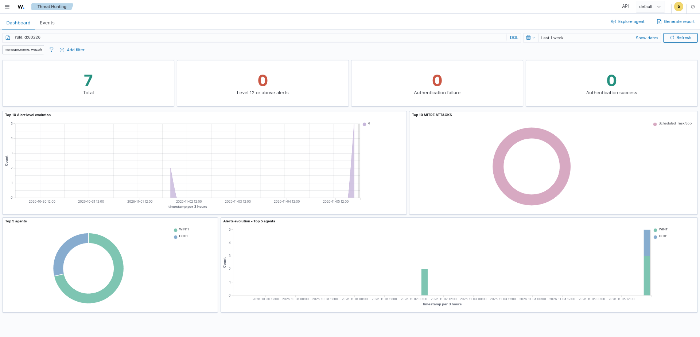
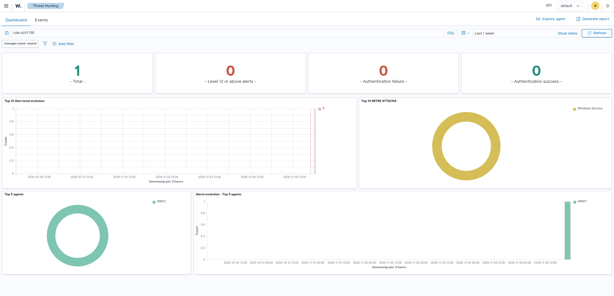

# Four Ways to Survive a Reboot, and Four Ways the SIEM Let Me Down

## Summary

An attacker who lands on a Windows box wants to still be there after a reboot.
The classic local ways are a Run key, the Startup folder, a scheduled task, and
a new service. I did all four on my lab machine, then went to the SIEM to catch
each one. The interesting part was not the attacks, which are easy. It was that
all four slipped past Wazuh at first, and each one for a different reason. One
rule was switched off. One fired but called the attack the wrong thing. One had
no log to match because the audit was off. One fired correctly but so quietly it
would never be seen. This is the third attack-and-detect write-up in my lab and
the Windows counterpart to my Linux persistence scanner.

## Lab setup

- Target: WIN11, a domain-joined Windows 11 client (`10.10.10.20`). It has
  Sysmon with the SwiftOnSecurity config, a Windows audit policy pushed by GPO,
  and a Wazuh agent.
- DC01: Windows Server domain controller and DNS (`10.10.10.10`).
- Wazuh: the SIEM where detections fire (`10.10.10.40`). I edit rules in
  `local_rules.xml` on this box and read the raw telemetry in `archives.json`
  against the alerts in `alerts.json`, which is faster than clicking the
  dashboard when I am checking whether an event arrived versus whether it
  alerted.

Everything below runs in an admin PowerShell on WIN11. Each attack is small,
reversible, and points at `calc.exe` as a harmless stand-in for a payload.

## The one idea behind the whole lab

A rule existing in the SIEM is not the same as that rule alerting. I had learned
this once before with Kerberoasting, where the detection logic shipped at level
0 and never surfaced. This lab turned that one lesson into four, because each
technique failed to alert in a different way. That is the real content here, so
I will call out the failure mode for each one.

## A. Run key

The oldest trick. A value under the `Run` key runs its command at logon.

```powershell
New-ItemProperty "HKCU:\Software\Microsoft\Windows\CurrentVersion\Run" `
  -Name "Updater" -Value "C:\Windows\System32\calc.exe" -PropertyType String
```

Telemetry: Sysmon Event 13 (RegistryValueSet). The writer is `powershell.exe`,
the target ends in `\Run\Updater`, the value is `calc.exe`. The event reached
Wazuh with every field correct.

Detection, first try: nothing alerted.

**Failure mode: the rule was silenced.** Wazuh already ships a rule (92300) that
matches Run-key writes and even tags them T1547.001. But it ships at level 0, so
it never surfaces. The logic was there the whole time, switched off.

Fix: a custom rule that anchors to the built-in and re-raises it, but only when
the thing writing the key is a script host or living-off-the-land binary rather
than a real installer. Installers write Run keys all day, so "any Run-key write"
is noise. "A Run key written by powershell or cmd or rundll32" is behaviour.

```xml
<rule id="100230" level="10">
  <if_sid>92300</if_sid>
  <field name="win.eventdata.image" type="pcre2">(?i)\\(powershell|pwsh|cmd|wscript|cscript|mshta|rundll32|regsvr32|reg|certutil)\.exe$</field>
  <description>Autostart persistence: Run key set by $(win.eventdata.image) (T1547.001)</description>
  <mitre><id>T1547.001</id></mitre>
</rule>
```



## B. Startup folder

Drop a file in the Startup folder and it runs at logon. No registry needed.

```powershell
"calc" | Out-File "$env:APPDATA\Microsoft\Windows\Start Menu\Programs\Startup\u.bat"
```

Telemetry: Sysmon Event 11 (FileCreate), target ending in `\Startup\u.bat`.

Detection, first try: an alert fired, but the wrong one. Wazuh rule 92201 lit up
at level 9 and tagged it T1105 and T1059, which are download and execution. It
saw "a script host created a scripting file under the user folder" and never
understood that the folder was Startup, which makes it persistence.

**Failure mode: the built-in fired but mis-classified the attack.** This is
worse than silence in a way, because the alert is there but points an analyst at
the wrong story. It also only triggers when a script host does the writing, so
the classic move, a shortcut dropped by Explorer, would slide down to a weak
level-6 alert, and a plain `.exe` in Startup would be missed entirely.

Fix: a rule that keys on the location. A file appearing in a Startup folder is
persistence, whatever its name and whoever wrote it.

```xml
<rule id="100231" level="12">
  <if_sid>92201</if_sid>
  <field name="win.eventdata.targetFilename" type="pcre2">(?i)\\\\Microsoft\\\\Windows\\\\Start Menu\\\\Programs\\\\Startup\\\\.+</field>
  <description>Autostart persistence: file planted in Startup by $(win.eventdata.image) (T1547.001)</description>
  <mitre><id>T1547.001</id></mitre>
</rule>
```

Getting this rule to fire taught me two things about how Wazuh actually works,
which I have put in the "what I learned" section because they cost me real time.



## C. Scheduled task

A task set to run at logon is persistence that also looks like normal admin work.

```powershell
schtasks /create /tn "WinUpdate" /tr "C:\Windows\System32\calc.exe" /sc onlogon /f
```

Detection, first try: no "a scheduled task was created" event at all. All I got
was a generic process-creation alert because `schtasks.exe` ran, plus a stored
Sysmon event for the task file appearing in `\System32\Tasks`. No real
persistence signal.

**Failure mode: the rule works, but the log it needs did not exist.** The
Windows event for task creation, 4698, is only written if the audit subcategory
"Other Object Access Events" is on, and it was off. Wazuh has a perfectly good
built-in for 4698 (rule 60228, T1053). It had nothing to match.

Fix was in the audit policy, not the ruleset:

```
auditpol /set /subcategory:"Other Object Access Events" /success:enable
```

I then made it permanent by adding that subcategory to the Audit Policy GPO on
the domain controller and running `gpupdate` on WIN11. I re-created the task and
a fresh 4698 fired, caught by the built-in 60228, so the detection now stands on
the GPO rather than a setting I typed once by hand.



## D. New service

A service with auto start runs at boot as SYSTEM. Heavy, loud, and common.

```powershell
sc.exe create FakeSvc binPath= "C:\Windows\System32\calc.exe" start= auto
```

Telemetry: System log Event 7045, "a service was installed", written by the
Service Control Manager. No special audit policy needed for this one.

Detection, first try: an alert fired and it was even tagged correctly, T1543.003.
But it was rule 61138 at level 5, which is below the line where anyone looks.

**Failure mode: the built-in was right but too quiet.** Same shape as the Run
key, where the logic was there but hidden, except here it was hidden by a low
level instead of level 0.

Fix: raise it when the service binary is suspicious, and leave it quiet when it
is not. A real service points at a program in its own folder. A malicious one
points at a LOLBin, a script host, or something in a user-writable or temp path.

```xml
<rule id="100232" level="12">
  <if_sid>61138</if_sid>
  <field name="win.eventdata.imagePath" type="pcre2">(?i)(\\\\(powershell|pwsh|cmd|wscript|cscript|mshta|rundll32|regsvr32|certutil)\.exe|\\\\(Users|ProgramData)\\\\|\\\\AppData\\\\|\\\\(Windows\\\\)?Temp\\\\)</field>
  <description>Service persistence: new service $(win.eventdata.serviceName) with suspicious binary (T1543.003)</description>
  <mitre><id>T1543.003</id></mitre>
</rule>
```

I tested both sides of this. The `calc.exe` service above sits in System32, so it
stays at the quiet level 5. A second service pointing at `cmd.exe` fired my rule
at level 12. That is the point: the tuning is on the binary, not on the fact that
a service was made.



## The four failure modes, side by side

| Technique | Built-in exists? | What went wrong | Where the fix went |
|---|---|---|---|
| A Run key | Yes (92300) | Shipped at level 0, silenced | The rule level |
| B Startup folder | Yes (92201) | Fired but tagged download/exec, not persistence | A re-tagging child rule on the location |
| C Scheduled task | Yes (60228) | No 4698 log to match, audit off | The audit policy (GPO) |
| D New service | Yes (61138) | Fired correctly but at level 5 | The rule level, tiered on the binary |

Two of these are rule problems, one is a telemetry problem, and one is a
classification problem. If I had only checked "is there a rule for this", I would
have said yes to all four and moved on, and caught none of them live.

## Tuning idea that runs through all four

Every fix keys on behaviour, not on the action by itself. Not "a Run key was
written" but "written by a script host". Not "a file was created" but "created
in Startup". Not "a service was made" but "its binary is a LOLBin or sits
somewhere a real service never would". Autostart locations are used constantly by
legitimate software, so a rule that alerts on all of them is a rule that gets
turned off. The signal is in who did it and what it points at.

## Cleanup

I removed all four afterwards and confirmed each was gone: the Run key value, the
Startup file, the scheduled task, and both services. The alerts stay in the
Wazuh dashboard as the record. A real detection lab is only honest if the box
goes back to clean at the end.

## MITRE ATT&CK

| Tactic | Technique | ID |
|---|---|---|
| Persistence | Registry Run Keys / Startup Folder | T1547.001 |
| Persistence | Scheduled Task | T1053.005 |
| Persistence | Create or Modify System Process: Windows Service | T1543.003 |

## What I learned

- A rule existing is not a rule alerting. I now check the level and test against
  the live attack, every time, instead of trusting that a matching rule means
  coverage.
- There is more than one way for a detection to fail. Across four techniques I
  hit four: a silenced rule, a mis-classifying rule, missing telemetry, and a
  correct-but-too-quiet rule. Knowing the shapes makes the next gap faster to
  spot.
- Two Wazuh mechanics that cost me time on technique B. First, Wazuh reports one
  rule per event, and it is the deepest rule on the first matching chain. A new
  rule written as a sibling of a built-in will not fire if the built-in already
  grabbed the event. I had to anchor my rule as a child of the exact built-in
  that was matching, so mine became the deepest node and replaced it. Second,
  the file-path fields come in double-escaped, so a path regex needs four
  backslashes per separator where you would expect two. My first version looked
  correct and silently matched nothing until I printed the raw field value and
  counted the backslashes.
- Honest gaps I did not fully close. My Startup rule covers files written by a
  script host, which is the common case, but a shortcut dropped by Explorer
  still only reaches the weak built-in. Closing that properly means keying on the
  Sysmon rule name or raising the built-in itself. I would rather write down the
  gap than pretend the rule is airtight.
- This is the same split I keep seeing: fixing the attacker's obvious move is
  easy, but the better work is deciding where the detection should actually live,
  the rule, the audit policy, or the sensor.
