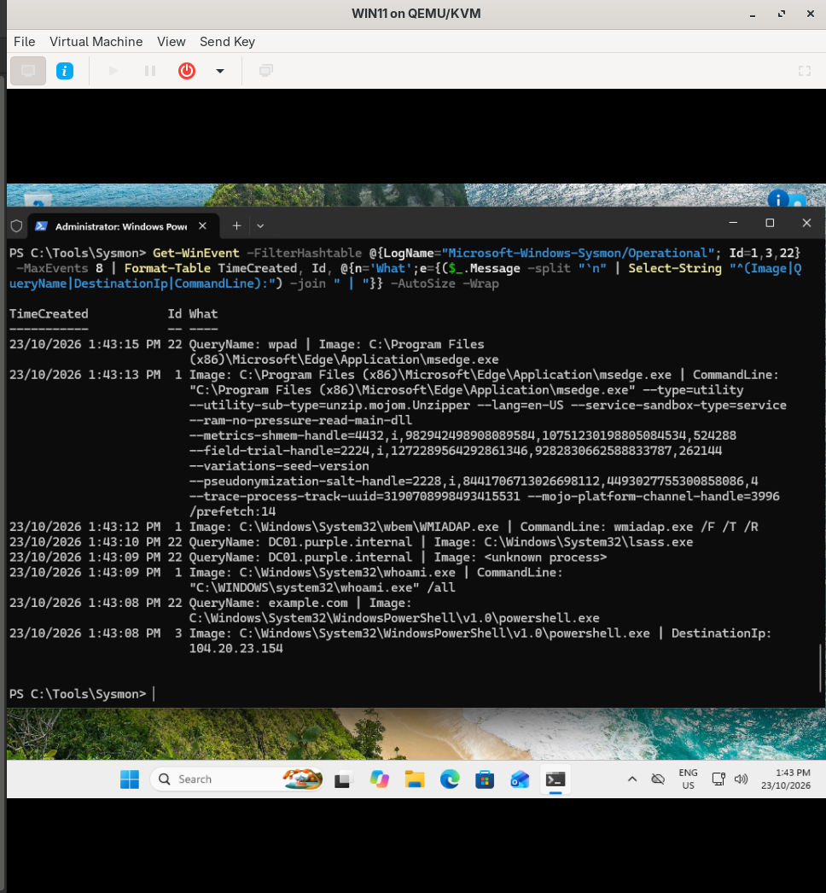
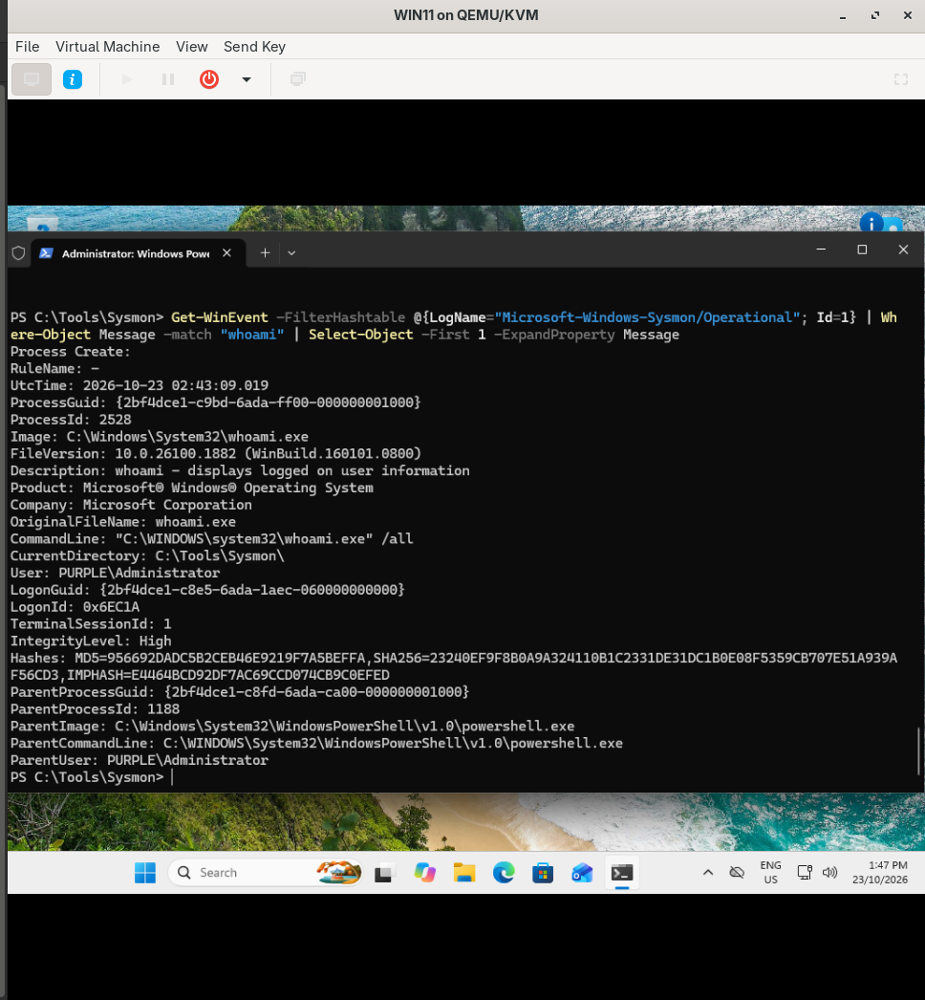

# Sysmon on WIN11

## Summary

After turning on audit logging, I installed Sysmon on WIN11. The Security log tells me a program ran. Sysmon also tells me its hash, what launched it, which domains it looked up and which IPs it connected to. I used SwiftOnSecurity's config, then tested it and read through the events.

## What Sysmon is

Sysmon is a free Microsoft Sysinternals tool. It has two parts:

- `SysmonDrv`: a kernel driver that sees things happen at a low level
- `Sysmon64`: the service that writes them to its own log, `Microsoft-Windows-Sysmon/Operational`

On its own it would log way too much, so it needs a config that says what to keep and what to skip. SwiftOnSecurity's config is the common starting point. It filters out normal Windows noise.

The events I looked at:

| ID | What it logs |
|---|---|
| 1 | Process created, with hashes, parent process and user |
| 3 | Network connection: which program connected to which IP and port |
| 22 | DNS query: which program looked up which domain |

## Install

On WIN11, in an admin terminal:

```powershell
mkdir C:\Tools\Sysmon -Force; cd C:\Tools\Sysmon
Invoke-WebRequest https://download.sysinternals.com/files/Sysmon.zip -OutFile Sysmon.zip
Expand-Archive Sysmon.zip -DestinationPath . -Force
Invoke-WebRequest https://raw.githubusercontent.com/SwiftOnSecurity/sysmon-config/master/sysmonconfig-export.xml -OutFile sysmonconfig.xml

# check it's really signed by Microsoft before running it as admin
Get-AuthenticodeSignature .\Sysmon64.exe | Format-List Status, SignerCertificate

.\Sysmon64.exe -accepteula -i .\sysmonconfig.xml
```

`-i` installs the service and the driver and loads the config. The output ended with `Sysmon64 started`.

Check it's running:

```powershell
Get-Service Sysmon64, SysmonDrv | Format-Table Name, Status
```

## Testing it

I did a few things an attacker might do after landing on a machine:

```powershell
ping -n 1 google.com
Invoke-WebRequest http://example.com -UseBasicParsing | Out-Null
whoami /all
```

Then pulled events 1, 3 and 22:

```powershell
Get-WinEvent -FilterHashtable @{LogName="Microsoft-Windows-Sysmon/Operational"; Id=1,3,22} -MaxEvents 8 | Format-Table TimeCreated, Id, @{n='What';e={($_.Message -split "`n" | Select-String "^(Image|QueryName|DestinationIp|CommandLine):") -join " | "}} -AutoSize -Wrap
```



Reading from the bottom up, Sysmon caught the whole chain from one command:

- 22: `powershell.exe` looked up `example.com`
- 3: `powershell.exe` connected to `104.20.23.154` (example.com)
- 1: `whoami.exe /all` ran

That link between program, domain and IP is what you need to spot something calling home.

At the top there's also a DNS query for `wpad` from Edge. That's Windows trying to auto-find a proxy. If DNS doesn't answer, Windows falls back to asking the local network, and an attacker can answer instead.

## One full event

```powershell
Get-WinEvent -FilterHashtable @{LogName="Microsoft-Windows-Sysmon/Operational"; Id=1} | Where-Object Message -match "whoami" | Select-Object -First 1 -ExpandProperty Message
```



The fields that matter most:

- `Hashes`: MD5, SHA256 and IMPHASH. A hash can be looked up on VirusTotal. IMPHASH is based on what functions the program imports, so it can link malware samples even when the files change.
- `OriginalFileName`: this comes from inside the file. If someone renames `whoami.exe` to `notepad.exe`, `Image` changes but this doesn't.
- `ParentImage` and `ParentCommandLine`: what launched it. Here it's PowerShell. Word launching PowerShell would be a big red flag.
- `IntegrityLevel: High`: it ran as admin.
- `LogonId`: links the process to the logon session in the Security log (4624).
- `UtcTime`: Sysmon always logs in UTC, so time zones don't mess up the timeline.

## Sysmon vs 4688

| | Security 4688 | Sysmon 1 |
|---|---|---|
| Command line | Yes (once turned on) | Yes |
| Parent process | Name only | Full path and command line |
| Hashes | No | Yes |
| Original file name | No | Yes |
| Network and DNS | No | Yes (events 3 and 22) |
| Built in | Yes | No, needs installing |

## What I learned

- Sysmon fills the gaps in the Security log: hashes, parent processes, network connections and DNS.
- The config matters as much as the tool. Without one, it's either too noisy or misses things.
- Check the signature of anything you download before running it as admin.
- `OriginalFileName` catches renamed tools.
- WPAD lookups happen on their own, and tools like Responder take advantage of that.

Next: [kerberoasting.md](kerberoasting.md) for the first full attack-and-detect loop.
